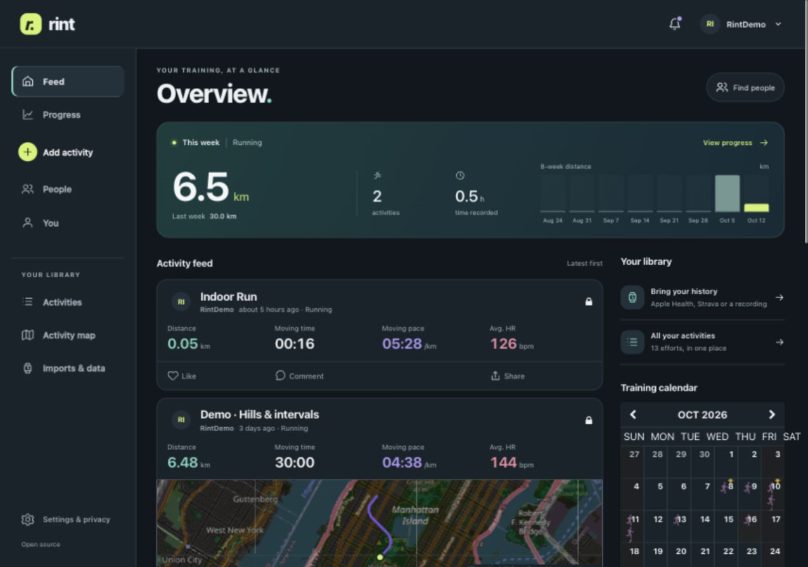

# Rint

> **This project is vibecoded.** Rint's changes are developed with AI assistance.

**Your fitness, your data.** A self-hosted activity tracker with detailed training
analysis, Strava imports, Apple Health integration, and native iPhone and Apple
Watch companions. An independent fork of [FitTrackee](https://codeberg.org/FitTrackee/FitTrackee), licensed under AGPL-3.0-only.

Rint is a **beta for evaluation**. Web and simulator checks are documented;
physical-device recording, background recovery and battery acceptance remain
open. See [validation](RINT_VALIDATION.md) and [device testing](apple/DEVICE_TESTING.md).



## What’s included

- A responsive activity feed, weekly training history, maps and personal bests.
- Distance, pace, heart rate, power, splits, laps and interval analysis when the
  recording includes them. No subscription is required for metrics or exports.
- Strava archive migration and Apple Health history import, with duplicate review.
- Native iPhone and Watch recording, local recovery and deferred synchronization.
- Follows, comments, reactions, audience controls and protected route sharing.
- Light and dark appearance, consistent metric colors, and optional interaction sounds.

## Run locally

Requires Docker and Docker Compose 2.30 or later:

```sh
python3 scripts/rint-configure.py
docker compose --env-file .env.rint -f compose.rint.yml up --build -d
```

Open [localhost:5080](http://localhost:5080) and register. The generated
`.env.rint` contains private secrets; keep it out of version control. This setup
binds the web port to localhost. Database and uploaded files persist in volumes.

The Docker deployment has not yet been smoke-tested in this checkout. The
PostGIS image targets Linux amd64; ARM hosts may require emulation. See the
[setup guide](RINT.md) for prerequisites, native development, HTTPS access,
backups and administrator setup.

For a public deployment, set `UI_URL` to your HTTPS origin and `RINT_SOURCE_URL`
to the published source for your deployed Rint revision before building. The
About screen displays this source link. See [release preparation](RELEASING.md).

## Develop and verify

The [development guide](RINT.md#local-macos-development) covers the local database,
backend and frontend. Generate the Apple project from `apple/project.yml` with
XcodeGen; generated projects and device-specific signing files are not committed.

```sh
python3 scripts/rint-release-check.py
npm --prefix fittrackee_client ci
npm --prefix fittrackee_client run lint-check
npm --prefix fittrackee_client run test:unit -- --run
npm --prefix fittrackee_client run build
```

[Architecture](RINT_ARCHITECTURE.md) · [Metric definitions](RINT_METRICS.md) ·
[Apple Health](RINT_HEALTH.md) · [UI evidence](RINT_DESIGN.md)

## Credits, upstream and license

Rint was originally forked from [FitTrackee](https://github.com/SamR1/FitTrackee).
Credit and thanks go to SamR1 and the FitTrackee contributors for building the
original project that Rint builds on. FitTrackee's upstream development is at
[FitTrackee on Codeberg](https://codeberg.org/FitTrackee/FitTrackee).

Rint starts with fresh Git history to keep clones small. Its original upstream
base is FitTrackee commit
[`d9cfb15`](https://github.com/SamR1/FitTrackee/commit/d9cfb15e6d2a5a3523dde7fbd5c098f6fb68357d).
The inherited source and license notices are retained.

The existing Python package and CLI retain the `fittrackee` and `ftcli` names for
compatibility;
backend version numbers refer to that upstream base. This project is not an
official FitTrackee release. The inherited publishing workflow is restricted to
the upstream repository and does not publish this fork.

[License](LICENSE) · [Upstream documentation](https://docs.fittrackee.org) ·
[Upstream changelog](CHANGELOG.md) · [Contributing](CONTRIBUTING.md)
