# Rint training experience — October 14

These are unedited screenshots from the running web app and iPhone/Watch
simulators. They use synthetic demo activities. They are not physical-device
screenshots, design mockups or proof of outdoor sensor accuracy.

## What changed

Training now has three distinct jobs: Week shows mileage and consistency;
Records shows the user's fastest sustained efforts across all history; History
finds the workout. A record opens its source activity and exact chart interval.
The sport selector and distance units remain explicit.

Activity details lead with a geographic route and a compact metric hierarchy.
Charts, best efforts and splits/laps have separate views. Sensor-only points
cannot fragment the map, and protected route gaps cannot be joined. Thirty-second
pace and a selectable full range keep the chart readable without changing the
underlying recording or record calculations.

Sharing is a composition flow: title, caption, photos, audience, protected
preview and the native share sheet. A private link explicitly grants no access.
Import handoffs lead to the activity library. Save/sync summaries distinguish
retention on the device, receipt by the phone and confirmation from the server.

The Watch uses large measurements and an explicit controls button. Pause/resume,
lap and finish fit together; finish has a confirmation. An interrupted paused
workout retains its clock and distance. The final fresh test stayed at 1:14 and
0.12 km across a multi-minute pause and app relaunch, then resumed and saved.

## Before and after

The older capture shows the previous annual training screen. The new captures
show Week and dedicated Records. The dates and demo activity set differ; these
are layout comparisons, not a comparison of fitness totals.

| Earlier training screen | Weekly training | All-time records |
| --- | --- | --- |
| 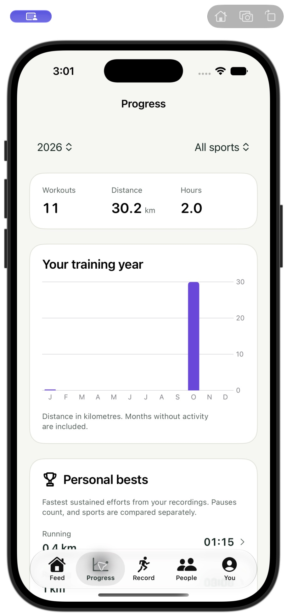 | 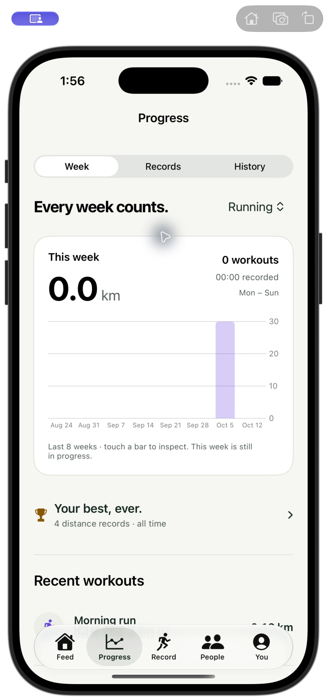 | 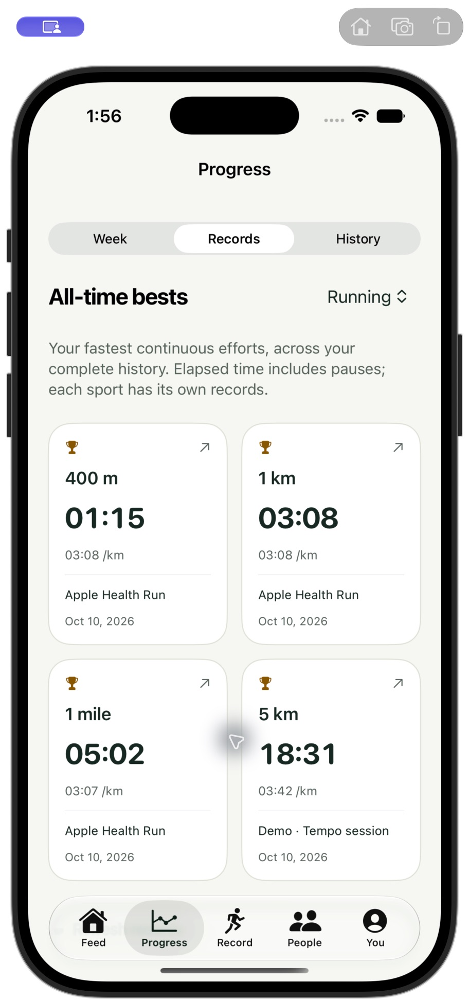 |

## Actual running screens

| Activity details | Per-workout efforts | Exact effort in the chart |
| --- | --- | --- |
| 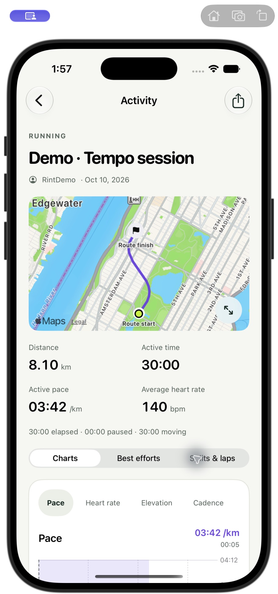 | 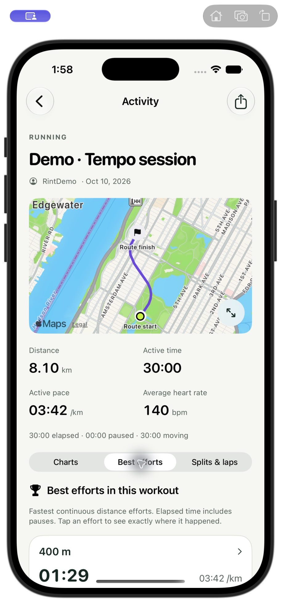 | 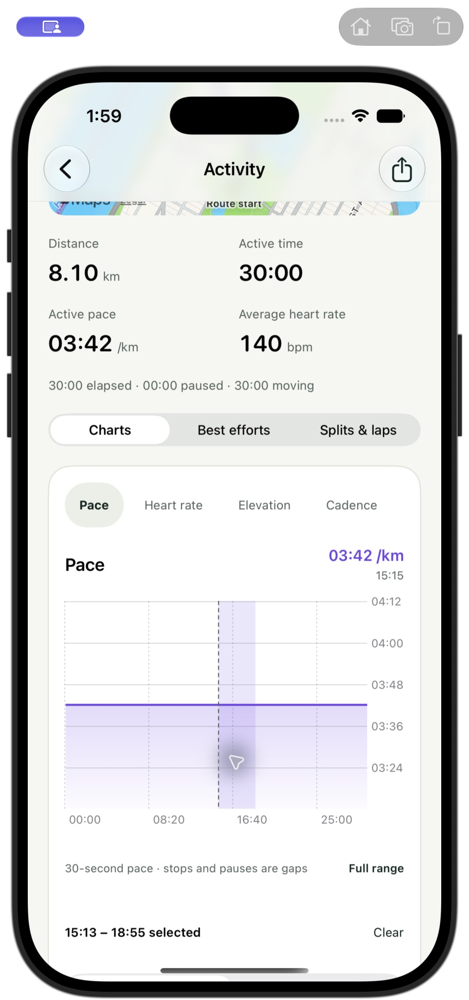 |

| Geographic route | Sharing composition | Mobile web activity |
| --- | --- | --- |
| 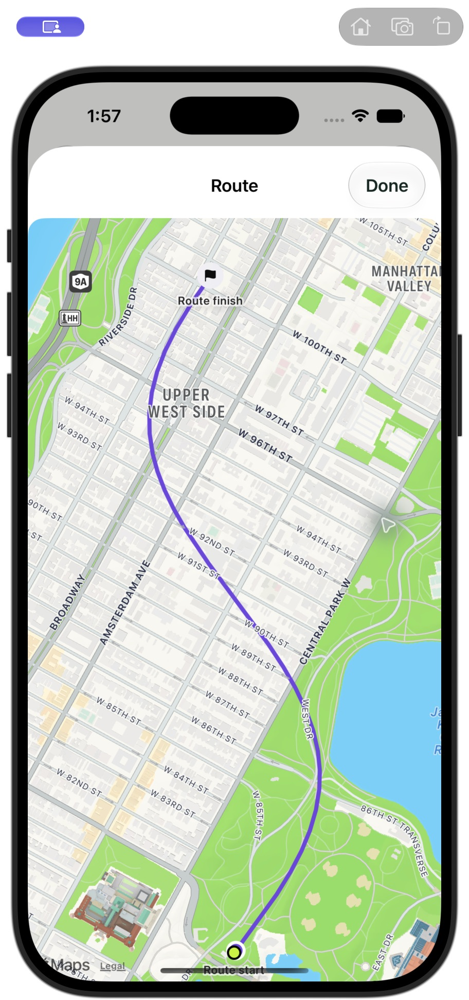 | 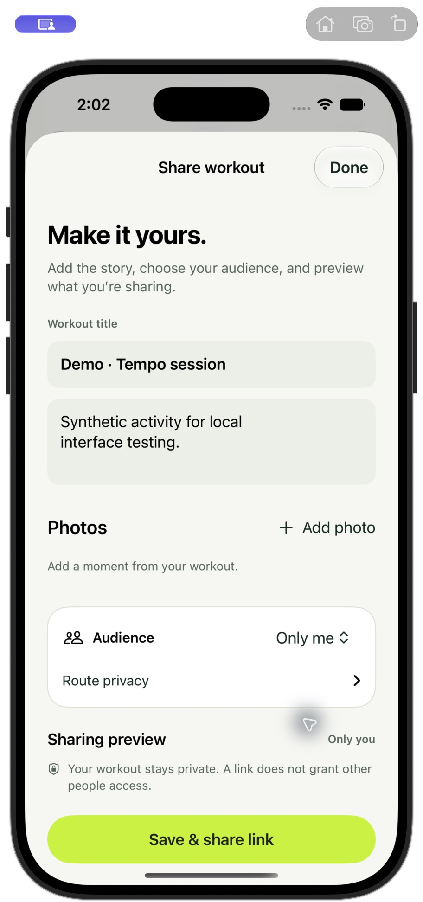 | 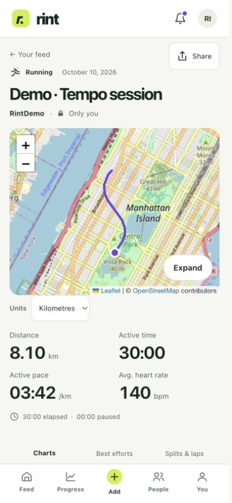 |

| Watch controls | Paused after recovery | Workout retained offline |
| --- | --- | --- |
| 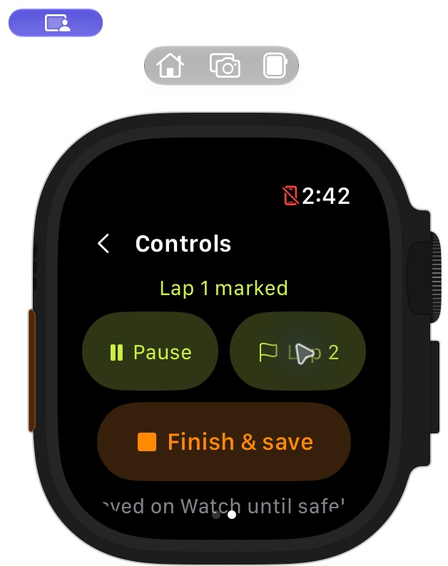 | 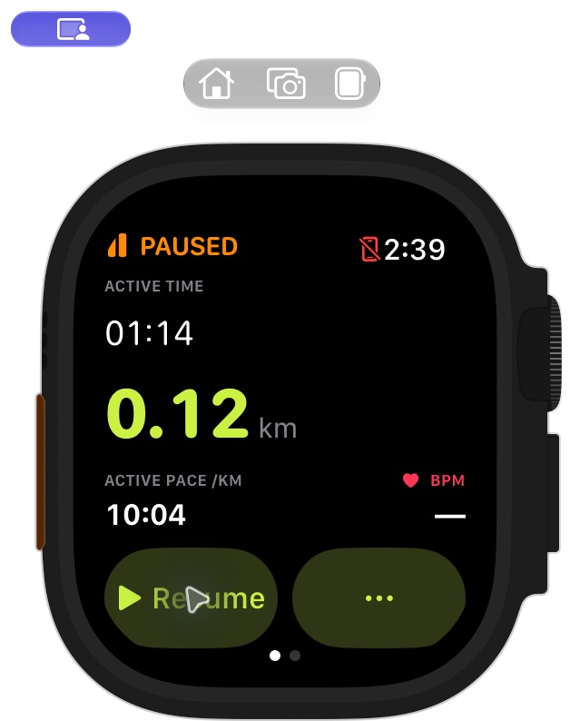 | 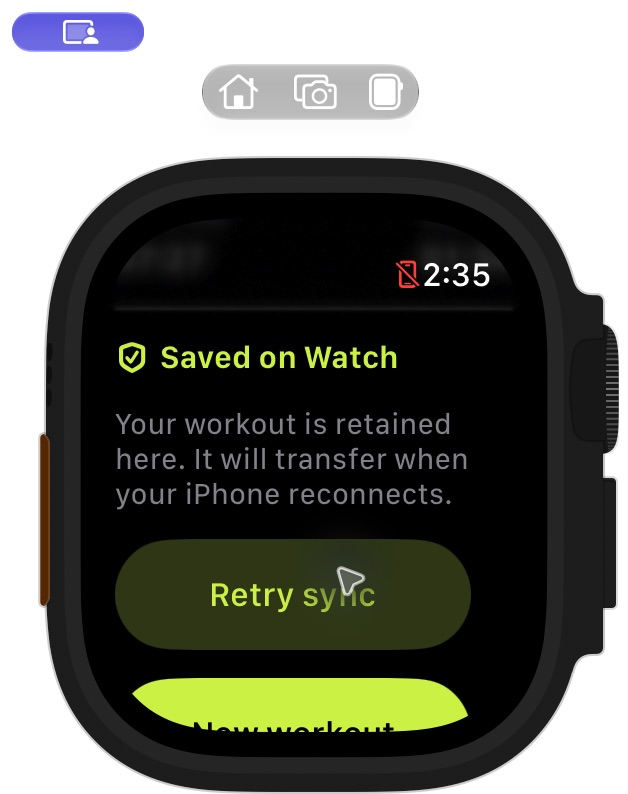 |

Additional evidence: [desktop records](web-records-desktop.png),
[320 px records](web-records-320.png),
[mobile per-workout efforts](web-workout-bests-phone.png),
[native chart drag at 15:00](iphone-chart-scrub-final.png),
[final retained Watch summary](watch-summary-final.png).

## Verification boundaries

42 backend tests, 416 web tests and 23 native tests pass. Three native opt-in
checks were skipped. Web lint/types/build and signed native builds pass. The
signed update was installed on the selected physical iPhone and paired Watch.

Physical outdoor recording, long background recovery, battery use and the final
Watch-to-phone-to-server acknowledgement still need hands-on acceptance.
Simulator does not support [Watch Connectivity file transfers](https://developer.apple.com/documentation/watchconnectivity/wcsession/transferfile(_:metadata:)).
Fresh Health permissions, comprehensive VoiceOver and slow-network acceptance
are not claimed. Native push delivery needs APNs/distribution setup. The private
server retains its closed registration and private Tailscale access.

See [validation details](../../../RINT_VALIDATION.md) and
[calculation methods](../../../RINT_METRICS.md). Metrics and exports remain free,
and the project retains AGPL-3.0-only.
