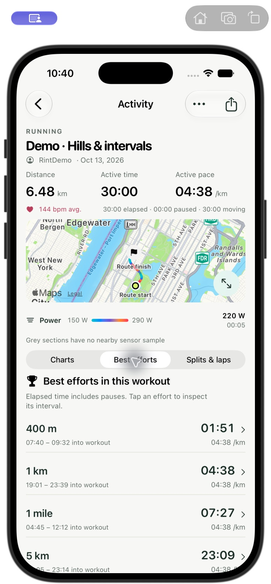
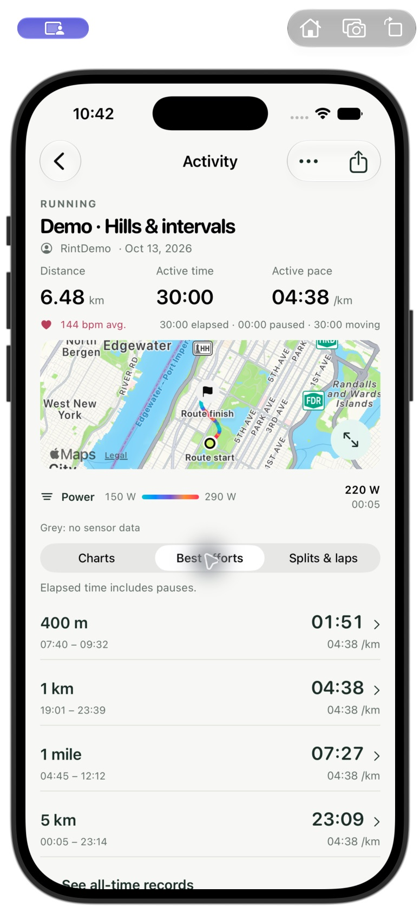
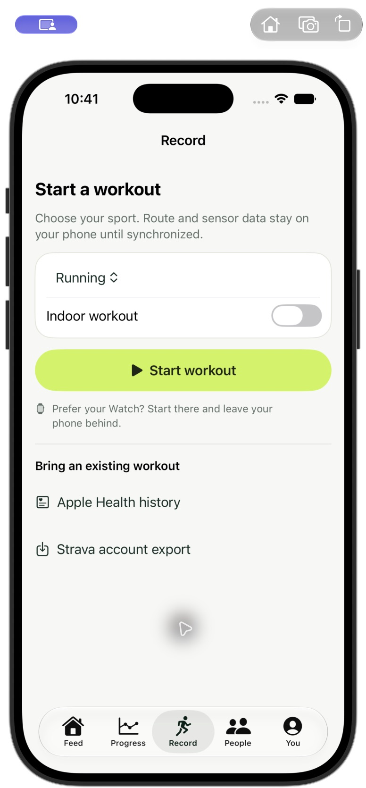
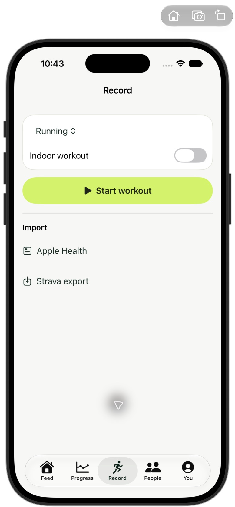

# Copy cleanup — October 16, 2026

Removed repeated slogans, instructions and headings from the main workout path.
Metric definitions, privacy explanations, error messages and sync/recovery
states remain available. No physical device was tested or updated.

| Before | After |
| --- | --- |
|  |  |
|  |  |

The native comparisons use the same simulator size, data and top scroll position.

- Feed: removed the web's second heading, default-order caption and brand
  slogan. Native uses a single Activities heading. Desktop sidebar content
  aligns with the first activity after the redundant heading is removed.
- Activity: removed headings that repeat the selected tab and “tap/select to
  inspect” instructions. Effort intervals retain explicit accessibility labels.
  Timing notes remain: elapsed time includes pauses.
- Recording: setup opens directly with sport, Indoor and Start controls. Import
  links are shorter. Active recording retains its saved-on-device indicator,
  errors, interrupted-recording recovery and pending-sync notices.
- Maps: shortened missing-power and missing-sensor explanations. Legends with
  no explanatory note no longer reserve an empty text row.
- Records: All-time bests replaces promotional wording. Time, pace, source,
  date and pause definitions remain.
- Health: shortened the introduction while retaining private-import and
  existing-visibility explanations. Sign-in loses its marketing paragraphs.
- Exports: shortened the native disclosure label and removed the repeated
  subscription promise. Export options and privacy controls are unchanged.
- Watch: completion keeps delivery status and concise offline-retention guidance;
  the generic instruction after confirmed server delivery is removed.

Web lint, types and production build pass. The iPhone simulator build, including
the Watch companion, passes; Swift formatting and whitespace checks pass.
No new tests were added or full suites repeated for this copy pass.

Actual UI checks: native feed, activity, effort rows, recording setup and Health
entry; web feed, exact 1 km interval navigation, Records and desktop layout.
Widths 320, 390 and 1280 remain within the viewport. The native 1 km row still
selects 19:01–23:39 with linked readouts. The demo server's temporary restart
error recovered through Try again. Watch completion was inspected, but its
lower content could not be scrolled using the automation in this pass.

The private HTTPS server serves the updated web page and current scripts/styles
with HTTP 200. Native changes are installed in the simulators only. Full Health,
recording and transfer workflows were not repeated; earlier validation is
documented in the density review.

Additional captures: [native activity](iphone-after-activity.png),
[native feed](iphone-after-feed.png), [Health](iphone-after-health.png),
[web feed](web-after-feed.png), [web efforts](web-after-efforts.png),
[320-pixel Records](web-after-records-320.png),
[desktop feed](web-after-desktop-feed.png),
[Watch completion](watch-after-completion.png).

Logs: `/private/tmp/rint-copy-{web-build,web-lint,native-build}.log`.
