# System appearance — October 14, 2026

## Behavior

- New accounts follow System instead of forcing Light. Existing explicit
  preferences remain intact. The requested personal account was set to System.
- Web appearance updates on live media-query changes and cached-page return.
  Settings → Preferences → Appearance offers System, Light and Dark. Guest
  appearance cycles through the same three choices.
- Semantic colours cover surfaces, controls and route measurement colours.
  Dark tiles do not invert the measurement overlay. Native iPhone already
  follows iOS; its light heart-rate colour was adjusted for readable contrast.
  Watch keeps its existing system dark appearance.
- Changing appearance preserves date format, timezone, units and visibility
  preferences, including after account data arrives asynchronously. The running
  review reproduced and fixed a preferences initialization bug and missing
  media/calories preference copying.

## Actual running-interface evidence

Unaltered captures from the local synthetic RintDemo account. No personal
workouts or physical-device captures are included. Phone web is 390 × 844;
desktop uses the browser's normal viewport. Temporary viewport settings were
reset, and the demo was restored to System.

The dark review first used the account's Dark override. Returning from Light
to System also produced the dark palette supplied by the current browser/OS.
The global Mac theme was not altered. Automated tests verify live OS changes;
these screenshots alone do not prove those events.

| Light override | System (current dark appearance) |
| --- | --- |
| 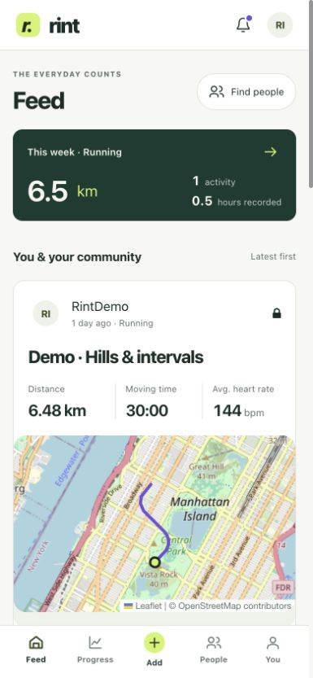 | 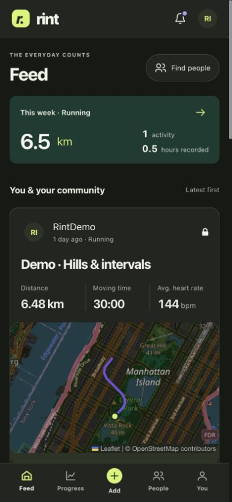 |

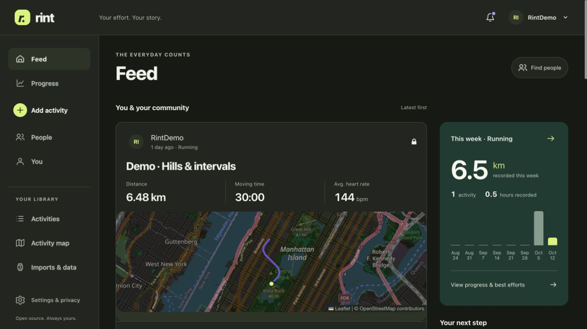

| Activity and map | Power chart |
| --- | --- |
| 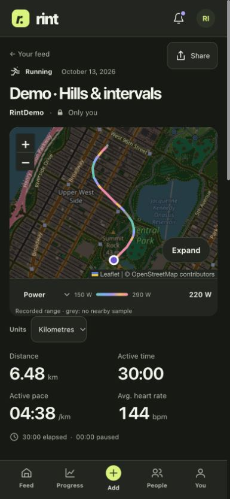 | 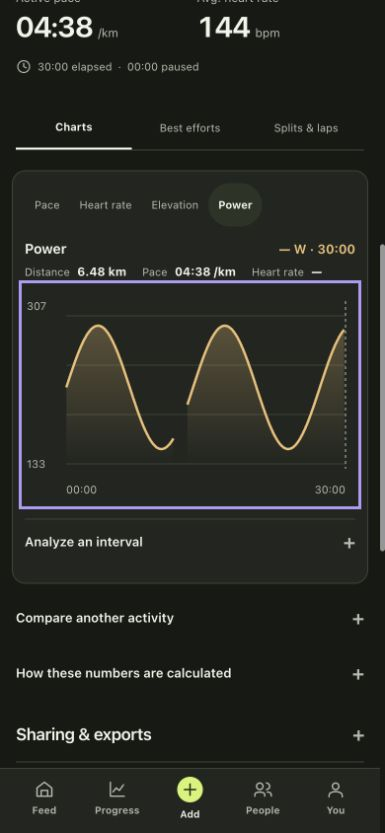 |

The chart was selected by keyboard through its accessible slider. The readout
updates at the selection and represents a missing sensor value honestly. This
round does not add a new physical touch claim.

| Weekly trend | Records |
| --- | --- |
| 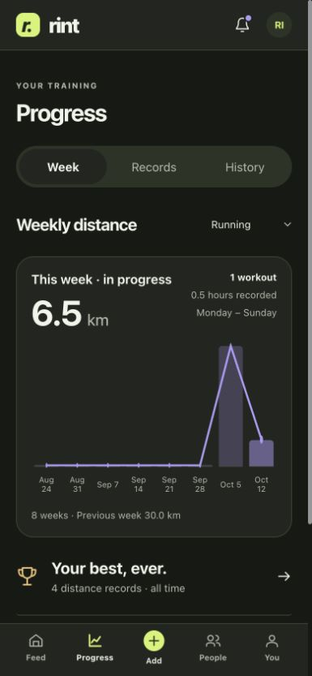 | 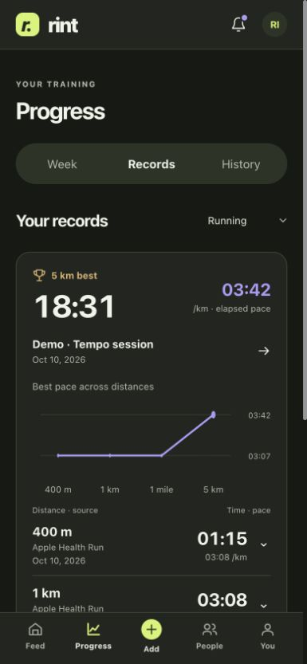 |

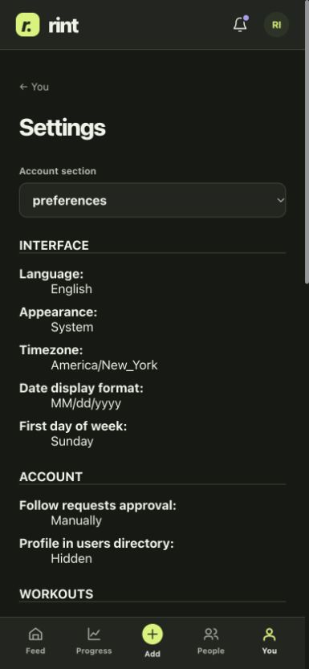

## Native simulator follow-up

After the Mac unlocked, the running iPhone 17/iOS 27 simulator was switched
through Features → Toggle Appearance. Rint changed light → dark without a
restart. Feed, activity metrics and Apple Maps routes adapted together.

| Native light feed | Native dark feed |
| --- | --- |
| 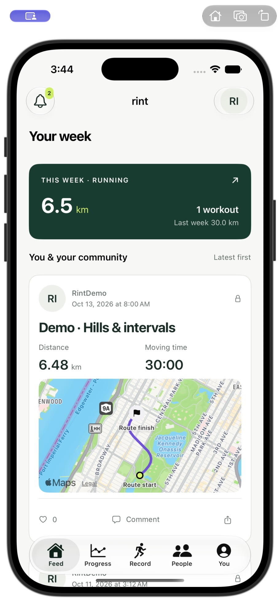 | 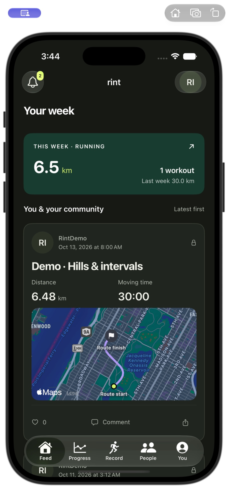 |

| Activity details | Direct chart tap |
| --- | --- |
| 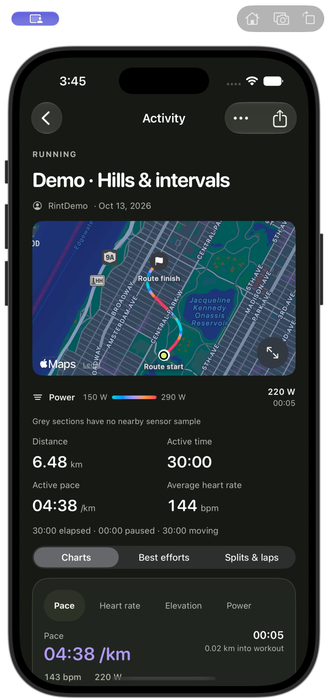 | 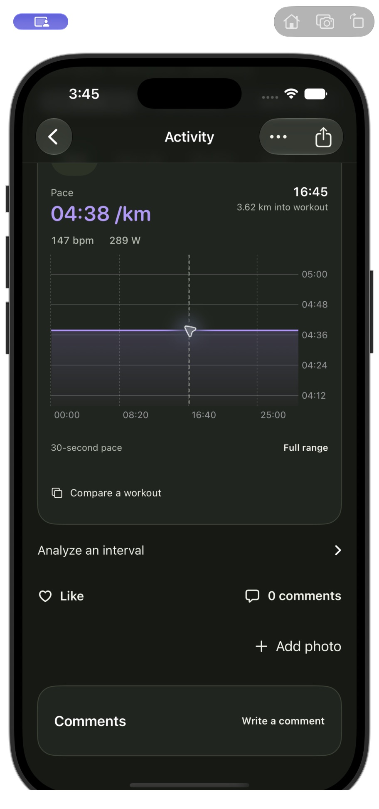 |

A direct pace-chart tap updated the persistent selection from 00:05 to 16:45,
including distance 3.62 km, heart rate 147 bpm and power 289 W. A gesture scrolled
the activity chart into view; drag-to-select reliability was not evaluated by
this appearance review.

| Current week | Tap on last week |
| --- | --- |
| 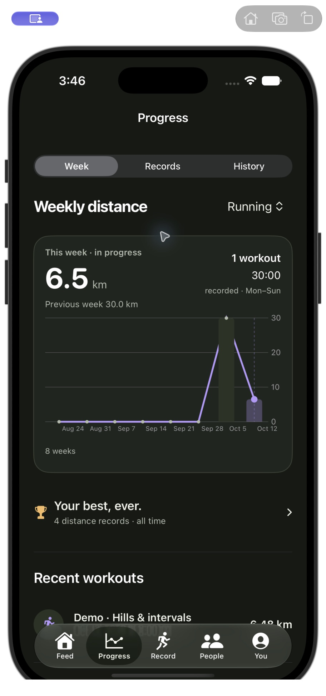 | 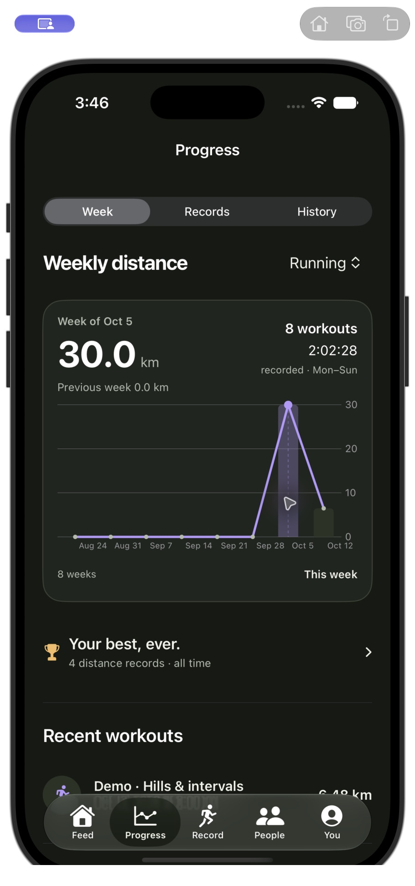 |

The weekly chart tap selected Oct 5 and updated the summary to 30.0 km, eight
workouts and 2:02:28 recorded time. Bars and the trend line stay within their
plot in this captured viewport.

| Records | Recording-ready controls |
| --- | --- |
| 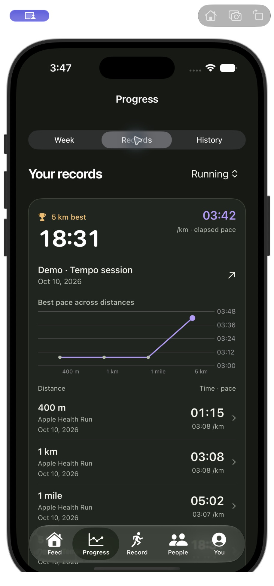 | 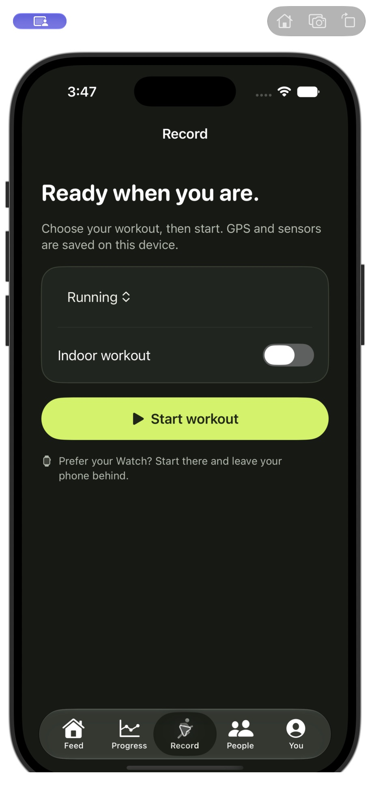 |

Finally, Toggle Appearance restored the simulator's original Light appearance
while Rint remained open. The Mac's global appearance was unchanged. No workout
was started by this review, and no physical devices were tested or installed.

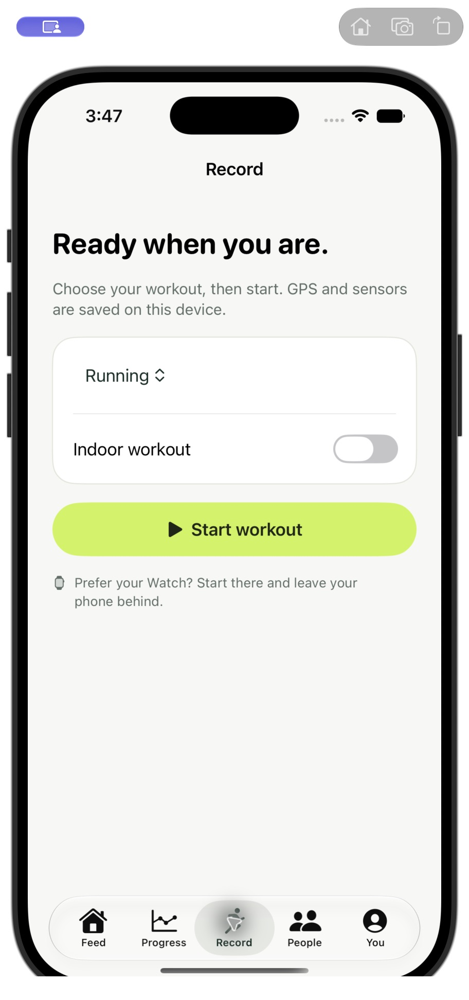

## Validation and limits

- Web: 425 tests, 23 files; lint, types and production build pass. The existing
  bundle-size warning remains.
- Backend: 14 targeted signup/default and appearance-preference tests pass.
- iOS simulator: 30 tests executed, 27 passed, three opt-in skips. The new test
  resolves both system palettes and checks normal text/metric contrast of at
  least 4.5:1 against paper, surface and soft panels.
- Native light/dark switching and the captured workflows above were visually
  checked after the Mac unlocked. No physical iPhone/Watch testing or
  installation took place. Background recording, transfer and battery behavior
  were not tested by this appearance review.
- Watch simulator reports system appearance switching unsupported. Its existing
  native dark UI was not changed by this round.
- The existing private HTTPS server was gracefully reloaded. API, root page and
  the current versioned interface script/style URLs return HTTP 200. No hosting
  access, privacy setting or public exposure was expanded.

Logs: `/private/tmp/rint-dark-{web-tests,web-lint,web-build,backend-tests,native-tests}.log`.

Rint's free charts, metrics and exports and AGPL license are unchanged.
