# Useful information density — October 15, 2026

Final iPhone simulator verification resumed and completed on October 16 after
the Mac was unlocked. The evidence directory retains its original date.

This refinement implements the supplied density brief across the responsive web
app, iPhone and Watch source. Screenshots use the isolated RintDemo account and
synthetic activities. No physical device was tested or updated.

## Comparable before and after

Each pair uses the same activity/data, viewport, section and top scroll position.
Browser phone captures are 390 × 844; desktop captures are 1280 × 850. Simulator
captures retain the same device window and scale. These are actual captures,
without cropping or compositing.

### Phone web activity

| Before | After |
| --- | --- |
| 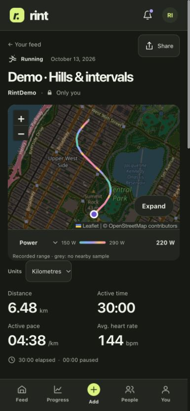 | 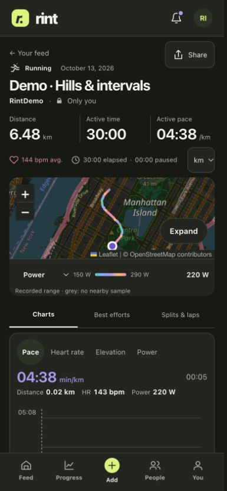 |

The primary metric row moves from y=587 to y=190. The chart begins at y=688
instead of y=962, **274 pixels earlier**, without reducing its 220-pixel plotting
height. The route remains geographic, expandable and coloured by recorded
power, heart rate or pace. The unit menu occupies its own safe place alongside
timing context; it no longer overlaps the activity title on narrow screens.
[Final DOM measurements](web-after-measurements.json) record the viewport and
absence of horizontal page overflow.

### iPhone feed

| Before | After |
| --- | --- |
| 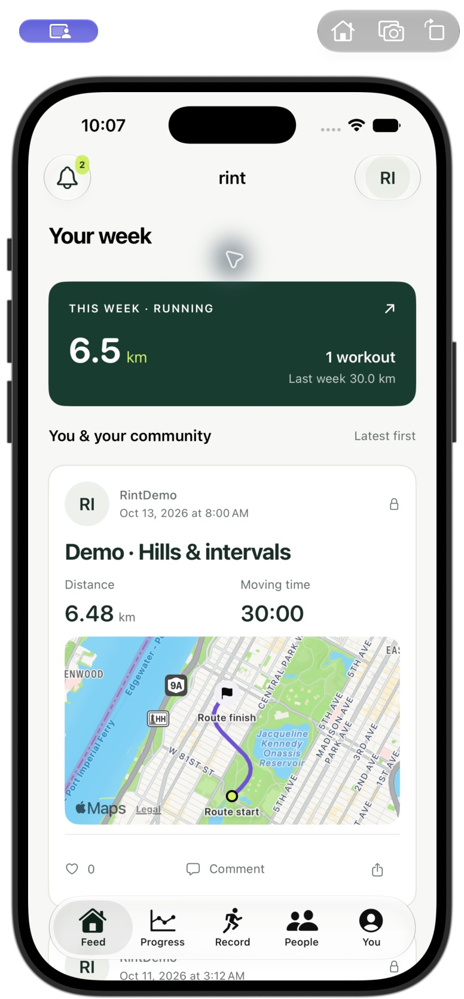 | 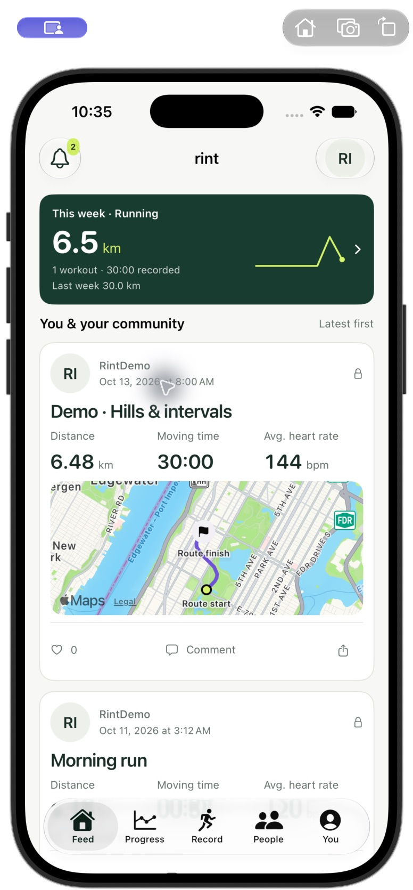 |

The compact weekly summary adds an actual eight-week trend and previous-week
comparison. The first workout card fits completely and the next workout starts
within the same viewport. Three aligned metrics include average heart rate
when available. The card's accessibility label explicitly retains title,
distance, moving time and heart rate after its layout changed to an adaptive
grid. Social actions and the profile avatar remain independent activity targets.

### iPhone activity and comparisons

| Before | After |
| --- | --- |
| 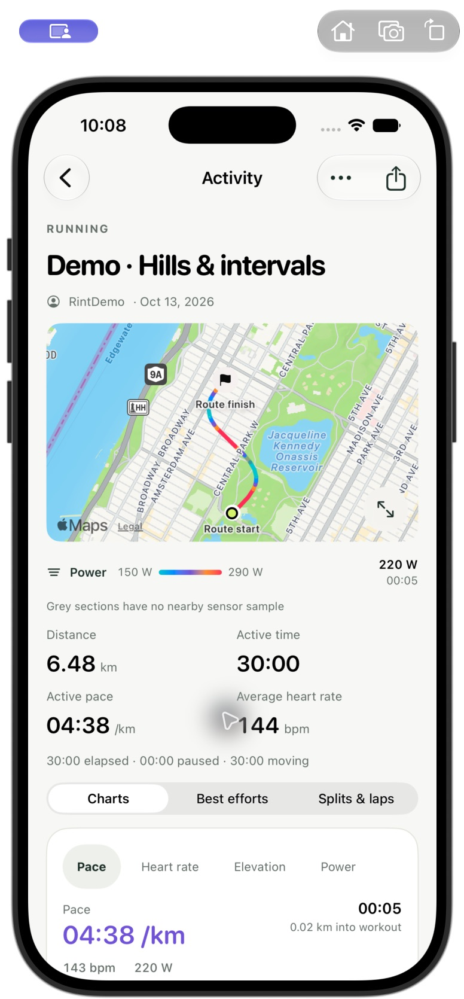 | 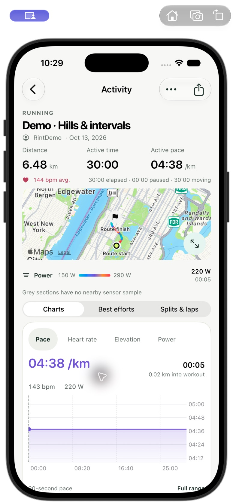 |
| 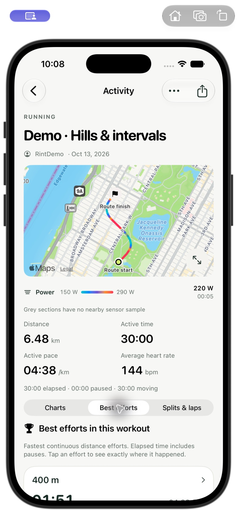 | 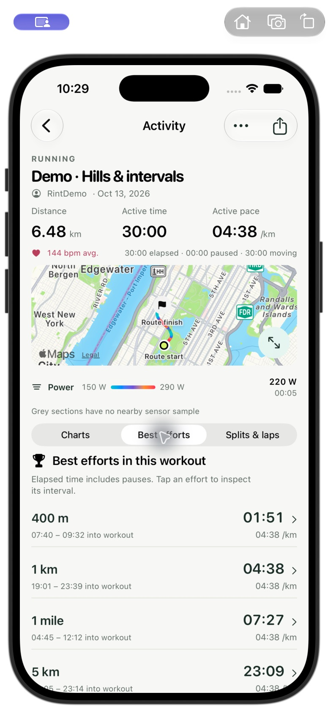 |
| 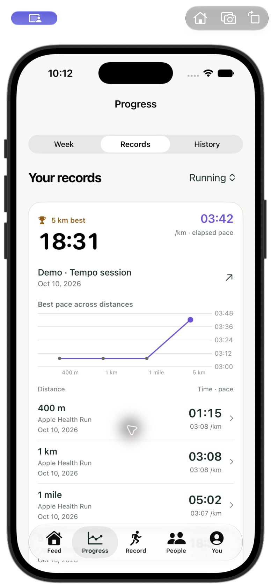 | 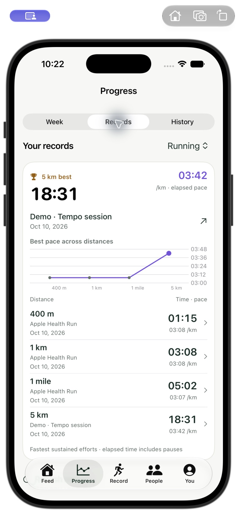 |
| 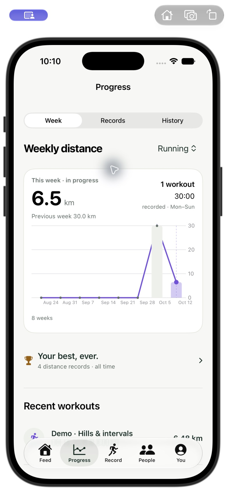 | 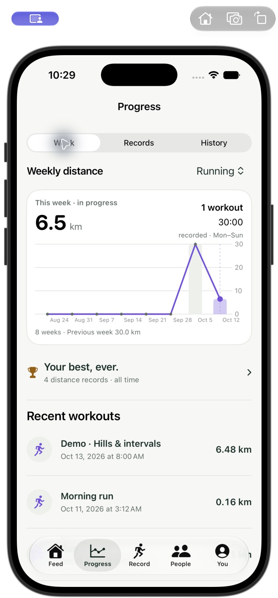 |
| 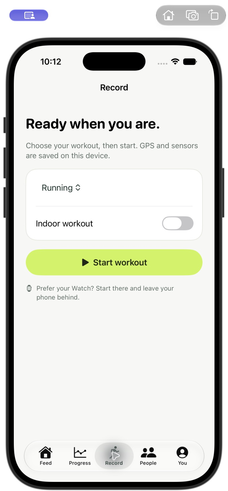 | 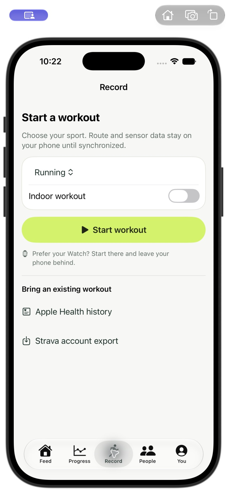 |

Final running checks caught a vertical separator through the effort rows and
pace-axis labels overlapping at accessibility text size. Efforts now group
distance/time on one line and interval/pace below it, separated horizontally.
Accessibility charts get more plotting height and fewer axis labels. Weekly
trend marks render above the bars. These fixes were rebuilt and visually
rechecked in the simulator.

### Desktop activity

| Before | After |
| --- | --- |
| 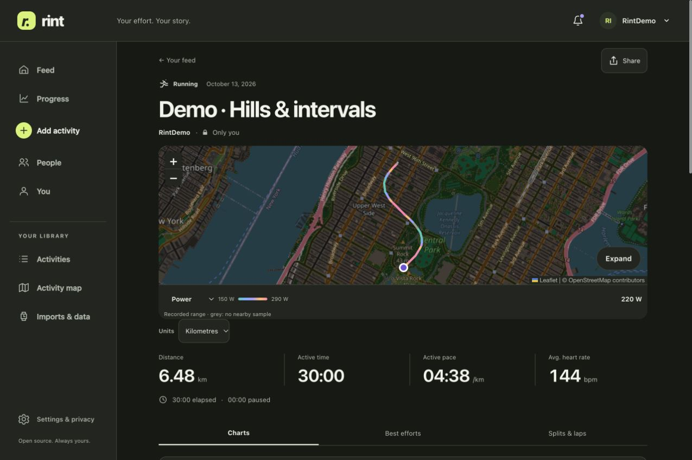 | 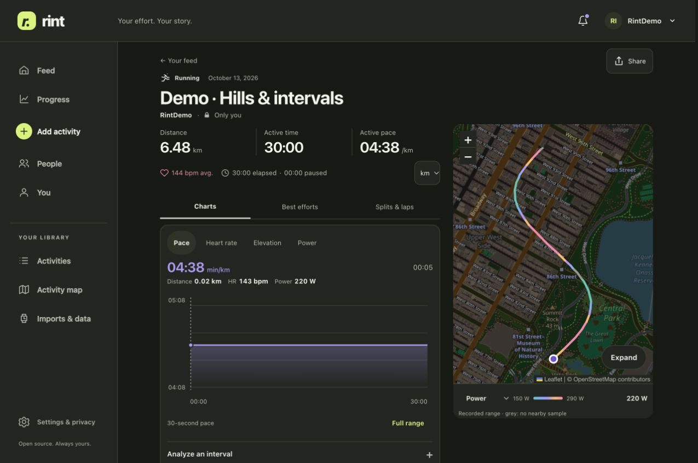 |

Desktop puts analysis beside the map. The split table now uses 45-pixel rows
while preserving a 44-pixel inspection button; all seven splits in the fixture
fit within the initial desktop viewport. The map height is capped so a long
table does not turn it into an unnecessarily tall column.
[Actual splits view](web-after-desktop-splits.png).

### Weekly progress and records

| Before | After |
| --- | --- |
|  | 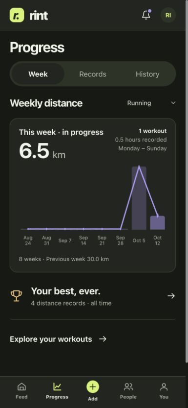 |
|  | 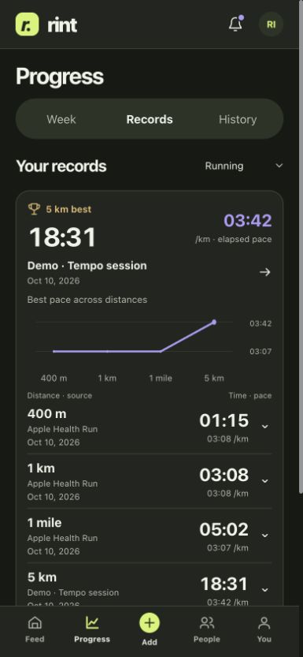 |

Records retain distance, time, pace, date and source. The curve compares best
pace across distances; it does not represent chronological record progression.
Per-workout bests are compact comparison rows with exact time windows and
direct chart navigation. [Per-workout efforts](web-after-efforts.png).

### Watch recording

| Before | After |
| --- | --- |
| 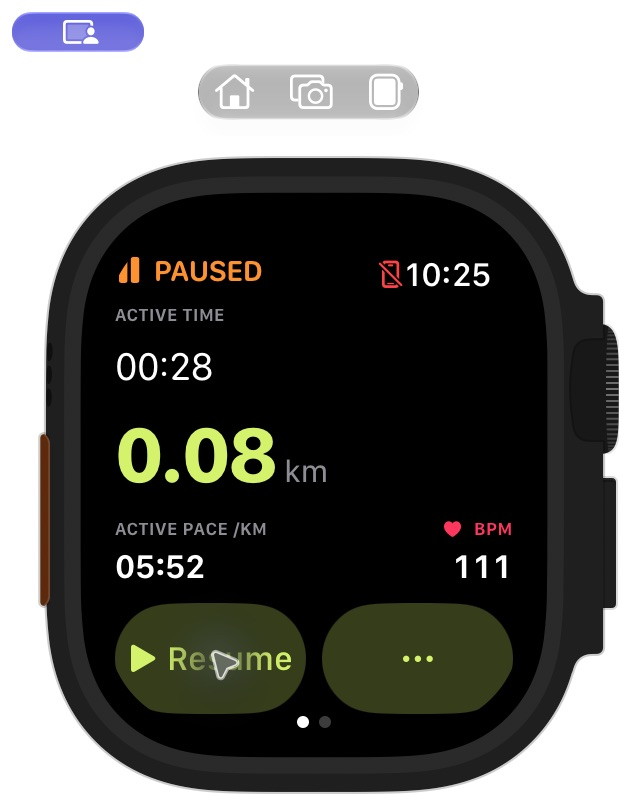 | 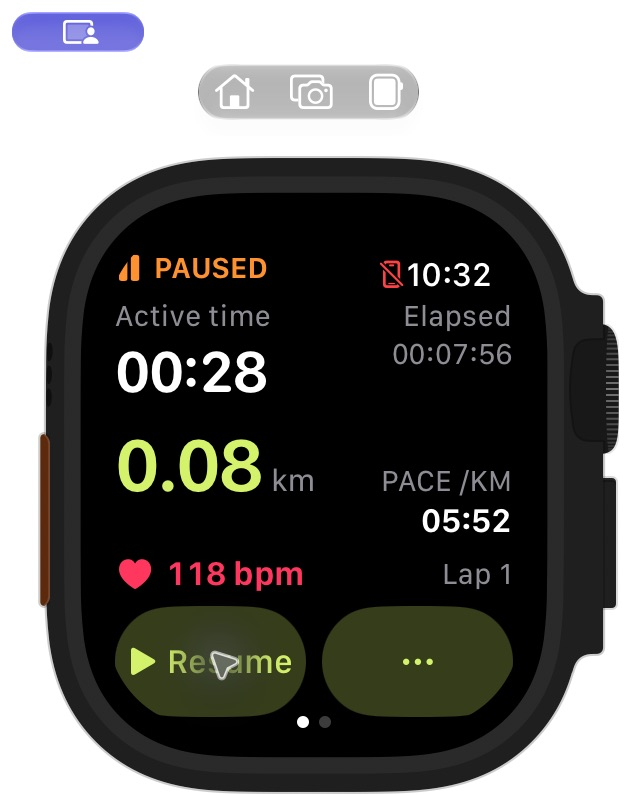 |

Both show the same paused simulator workout at **00:28 active time and 0.08 km**.
Elapsed wall time and simulated live heart rate differ between captures. The
new glance screen includes active and elapsed time, distance, pace, heart rate,
lap number and Resume/More controls together. A wrapped elapsed-time label found
in the running review was corrected. Very large text uses a scrollable layout.

## What changed

- Feed summaries group mileage, time, activity count and real trends; repeated
  introductory headings and excess media height are reduced. Route/photo cards
  keep their full activity hit areas and independent social controls.
- Activity details place distance, active time and pace together, with average
  heart rate and elapsed/paused context immediately below. Mobile routes are
  compact but expandable. Desktop analysis and map share the available width.
- Selected chart values are visually stronger; linked time, distance and sensor
  readings remain adjacent. Narrow layouts wrap metric/zoom controls rather
  than clipping their labels. No inspection slider or additional mode is added.
- Best efforts and records use comparison rows, restrained separators and clear
  source/date context instead of equally weighted large tiles.
- iPhone recording groups the main readouts, reduces empty spacing and adds
  direct Apple Health/Strava history entry points to the ready screen. Recording
  controls, offline recovery and completion states retain their existing logic.
- Map framing is recalculated when the actual map container changes size, so
  responsive transitions retain an appropriate geographic view.
- A redundant scroll-to-top control is hidden at the top of the page.

## Operated workflows

| Workflow | Observed result |
| --- | --- |
| Web activity chart tap | A direct tap selected 13:20 and updated pace, distance, heart rate and power together; keyboard Right selected 13:30. |
| Workout effort → chart | The 1 km row selected and zoomed to 19:01–23:39 in the hills activity. |
| All-time record → source | The 5 km record opened Tempo session with 00:00–18:31 highlighted, including at 320 pixels. |
| Narrow selected chart | A direct tap in the selected 5 km chart changed the linked time to 07:50 and distance to 2.12 km. All metric labels and Reset zoom remained available without clipping. |
| Weekly selection | Selecting Oct 5 changed the summary to 30.0 km, eight workouts and 2.0 recorded hours. |
| Sharing and free export | The existing Only me audience and 200 m route protection remained visible. A CSV export downloaded successfully. No public sharing or external message occurred. |
| iPhone feed social action | Like toggled independently while the app stayed on Feed. The full workout card and next workout were visually inspected. |
| Repeated iPhone chart taps | Taps changed linked readouts to 21:41 / 4.68 km / 130 bpm / 182 W, then 06:35 / 1.42 km / 134 bpm / 230 W. Selection persisted after release. [Capture](iphone-after-chart-tap.png). |
| Native effort and record navigation | The workout's 1 km effort selected 19:01–23:39. The all-time 5 km record opened Tempo session with 00:00–18:31 selected; Back retained the Records section. [Workout interval](iphone-after-selected-effort.png), [record source](iphone-after-record-source.png). |
| Native weekly selection | Tapping Oct 5 changed the summary to 30.0 km, eight workouts and 2:02:28. [Capture](iphone-after-week-selection.png). |
| Native Health entry point | Recording-ready → Apple Health history opened the existing history selection/review screen with setup complete. No historical import was rerun. [Capture](iphone-after-health-entry.png). |
| iPhone recording and recovery | A synthetic indoor recording started, paused and marked a lap. Termination/relaunch retained Paused, 0.05 km, pace 05:52 and Lap 2. Resume → Finish → explicit confirmation saved 0.05 km, 00:25 active, 01:09 elapsed and 00:44 paused. The completion screen reported Saved on this iPhone and Synced to Rint. [Active](iphone-after-recording-active.png), [recovered](iphone-after-recording-recovered.png), [completion](iphone-after-recording-synced.png). |
| New recording → analysis → sharing | View workout & share opened the new Indoor Run with its own free sensor charts and a compact No GPS route available state. Its sharing editor showed Only me. No external destination or publication was selected. [Analysis](iphone-after-recording-activity.png), [sharing](iphone-after-recording-sharing.png). |
| Watch interruption recovery | A paused workout retained 00:28 active time and 0.08 km through termination, replacement of the simulator app and relaunch. Paused values remained stable for approximately seven minutes. |
| Watch controls and completion | Resume → More → mark lap → finish confirmation → save produced a durable 0.08 km / 00:55 active summary marked Saved on Watch. [Controls](watch-after-controls.png), [saved summary](watch-after-saved.png). |
| Light/system appearance | Web feed, activity and records were reviewed in light and dark. The demo account was restored to System. [Light activity](web-after-activity-light.png), [light feed](web-after-feed-light.png), [light records](web-after-records-light.png). |
| Native system appearance | The running iPhone switched light → dark → light without restarting for appearance changes. Activity, efforts, records, weekly progress and recording-ready were captured in dark mode. [Activity](iphone-after-activity-dark.png), [records](iphone-after-records-dark.png), [week](iphone-after-week-dark.png), [recording](iphone-after-recording-dark.png). |
| Accessibility text size | The simulator changed from Large to Accessibility Medium. Feed metrics reflowed to one column; activity metrics used two columns. Records and weekly charts used readable axis spacing after the correction. The original Large size and Light appearance were restored. [Records](iphone-after-records-large-text.png), [week](iphone-after-week-large-text.png), [activity](iphone-after-activity-large-text.png), [recording](iphone-after-recording-large-text.png). |

The new 0.05 km indoor fixture was created **after** the comparable layout
captures. It remains in the isolated demo account and is separate from the
user's personal server and workouts.

## Validation and remaining limits

- Web suite: **425 passing tests across 23 files**. Lint, type checking and the
  production build pass. Existing bundle-size warnings remain.
- iOS simulator suite: **30 executed, 27 passing and three opt-in skips**.
  The iPhone and Watch simulator builds succeed.
- Reviewed browser sizes include 320, 390, 820 and 1280 pixels. The 320-pixel page
  width remains within its viewport. [Narrow overview](web-after-activity-320.png),
  [narrow records](web-after-records-320.png).
- The responsive map was checked after changing phone → desktop size; settled
  tiles and route reframed correctly. Two route-wrapper regression tests pass
  after the resize fix. The existing private HTTPS server was gracefully
  reloaded; its page and current interface JavaScript/CSS return HTTP 200.
- The previously blocked iPhone visual checks were completed on October 16.
  Native feed accessibility labels and the visible layouts at Accessibility
  Medium were inspected. The axis-label overlap found there was corrected and
  rechecked. This is not exhaustive coverage of every accessibility size or
  VoiceOver interaction.
- Native taps worked reliably. Simulator drag and scroll input still did not
  reliably move the iPhone view; finger scrubbing and vertical scrolling through
  off-screen content remain unverified by this automation. Device performance
  and physical touch behavior are not certified by these captures.
- Simulator WatchConnectivity file transfer is unsupported. The durable Watch
  summary proves local retention, not successful phone/server delivery. Health
  permissions, background recording, outdoor GPS and battery use were not newly
  tested. No physical device was contacted or installed.
- Backend metrics, recording files, import/sync architecture, privacy settings,
  free charts/exports, the AGPL license and self-hosting model are preserved.
  Complete migration and Health flows were not rerun for this layout change.

Logs: `/private/tmp/rint-density-{web-tests,web-lint,web-build,native-tests,native-build,watch-build,route-tests}.log`.
