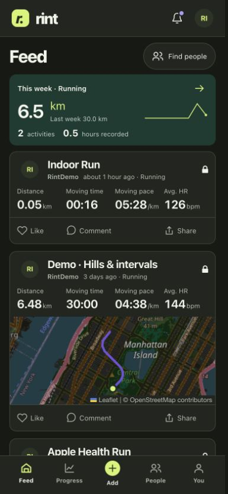
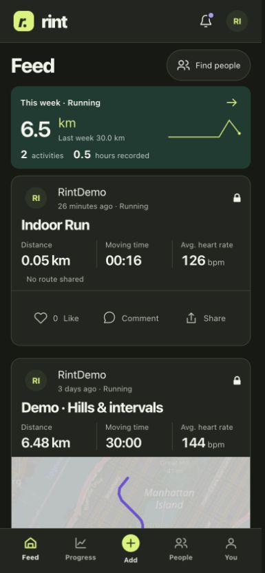
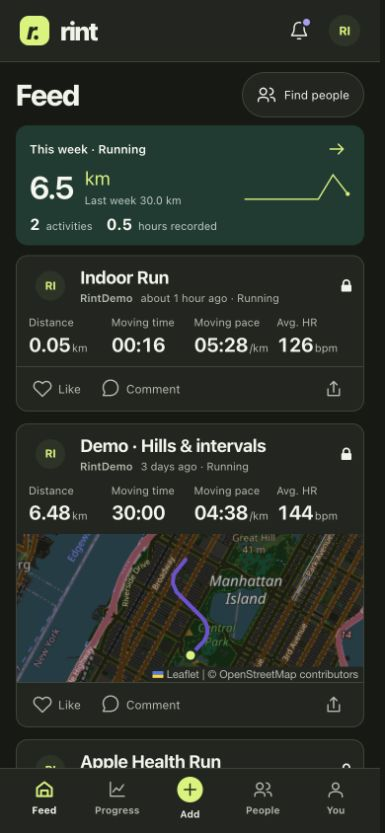
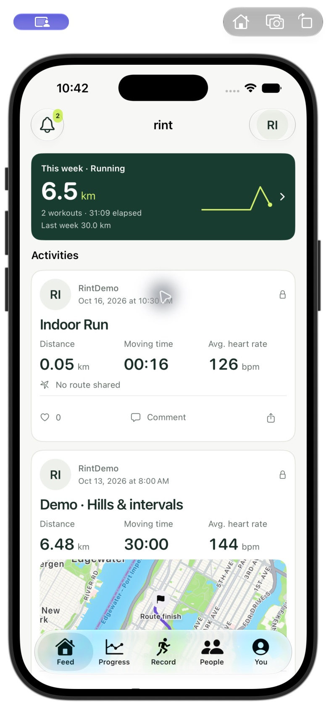
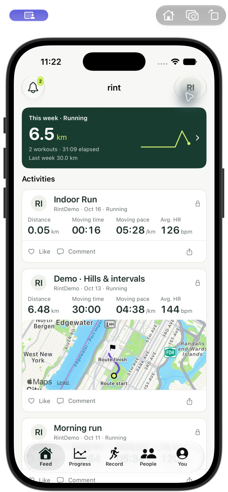

# Feed composition — October 16, 2026

This pass addresses the oversized workout card in the user's screenshot. The
shared web and iPhone feed cards also appear on profiles. Other screens retain
the preceding redesign; this is not a claim that every product gap is closed.

## Follow-up: shared alignment

The footer now uses the same 12-pixel inset and eight-pixel column gaps as the
metrics. With four metrics, Like starts at column one, Comment spans columns two
and three, and Share starts at column four. Three-metric cards use three matching
columns. At narrow web widths the metrics reflow and the footer keeps three
readable actions inside the same content inset.

At 390 pixels the measured metric starts are 29, 112.75, 196.5 and 280.25;
the action icons start at 29, 112.75 and 280.25 exactly. The desktop check also
confirms matching starts. The footer remains 45 pixels tall with 44-pixel targets.
At 320 pixels all labels fit their 80.33-pixel targets without overflow.

The web lint, types, production build and five targeted card tests pass after
this adjustment. The iPhone/companion simulator build passes. The actual iPhone
feed was inspected and Like/undo operated without opening the activity. Enlarged
text uses stacked actions aligned with the single-column metrics; its final
screenshot could not be completed because native control switched to the Watch
window and then timed out. The last successful native capture uses Light/Large.
No physical-device build was installed. Full suites were not repeated for this
layout-only follow-up.

[Narrow web view](web-aligned-actions-320.png) ·
[Desktop view](web-aligned-actions-desktop.png) ·
[Actual iPhone simulator view](iphone-aligned-actions.png)

## Design decisions

- Lead with the workout title. Keep author, date and sport together as supporting
  context, with an explicit avatar target for the profile.
- Use one aligned metric group: distance, moving/elapsed time, corresponding
  pace/speed and available heart rate (or web elevation). Retain readable type.
- Give routes and photos a continuous media area. Omit an empty route row in the
  feed; keep explanations in activity details and preserve loading/error states.
- Align Like, Comment and Share to the metric grid. The single action row
  keeps 44-pixel minimum hit targets without a padded container around them.
- Keep calm surfaces, subtle separators, consistent alignment and existing
  semantic colours. Useful density comes from hierarchy and grouping. Enlarged
  text and narrow screens reflow rather than squeeze the content.

The previous web Comment link used content-box sizing: its 48-pixel minimum
height plus vertical padding made it 68 pixels tall, forcing an 81-pixel footer.
All action controls now explicitly use border-box sizing.

## Actual measurements

Same synthetic RintDemo Indoor Run, 390 × 844 browser viewport, dark system
appearance, at the top of the feed. Measurements are browser layout pixels.

| Element | Before | After |
| --- | ---: | ---: |
| Entire card | 250.75 | 158.30 |
| Header | 84.25 | 54.00 |
| Metrics | 60.50 | 57.30 |
| Empty route message | 23.00 | omitted |
| Social action row | 81.00 | 45.00 |
| Available metrics | 3 | 4 |

The card is 36.9% shorter; social controls remain at least 44 × 44 pixels.
No horizontal page overflow was observed at 320, 390 or 1280 pixels. At 320,
four metrics use a two-column layout. The desktop route is 693 × 150 pixels;
its rendered route fits inside the map with space around it.

| Mobile web before | Mobile web after |
| --- | --- |
|  |  |

The native before capture is the actual light/Large-text feed from the preceding
copy-cleanup round, copied unchanged here. The after capture uses the same
simulator, appearance, text size, account and activities. Native and web titles
for the older Health fixture differ because native normalizes the display title.

| iPhone before | iPhone after |
| --- | --- |
|  |  |

## Metrics and interaction checks

Feed pace/speed uses the original summary distance and the explicitly labelled
moving time, falling back to elapsed time when moving time is absent. Fractional
seconds are retained until the final unit conversion/display rounding. Zero
distance and subsecond recordings do not produce a misleading pace. No sensor
stream is synthesized and no original recording is changed.

Actual browser checks operated Like/undo without leaving the feed, the metrics
target into the Indoor Run, the Hills route into its activity, and the avatar
into RintDemo's profile. Actual iPhone simulator checks operated Like/undo,
avatar/profile, the Hills card body into activity details, Comment into the
comment composer, and Share into the existing Only me editor. No comment was
posted and no activity was published or made public.

The iPhone feed was inspected in Light and Dark, then at Accessibility Medium
text in Dark. Larger text switches metrics to a readable single column. The
simulator was restored to Light/Large. These native controls are still distinct
from the broad activity target.

## Verification and limits

- Web: 430 tests in 24 files pass; lint, types and production build pass. The new
  card tests cover precision/unit conversion, explicit time basis, missing and
  subsecond data, and independent action navigation.
- iPhone simulator: 31 tests executed, 28 passed and three opt-in integration
  checks skipped. The build includes the Watch companion. The added native test
  covers precise duration conversion and malformed/missing durations.
- The final spacing-only web change was followed by another successful
  production build. No backend or database change was required.
- The existing private web server was refreshed. Its home page and current
  JavaScript/CSS assets return HTTP 200 locally. Tailscale still shows the
  existing tailnet-only HTTPS proxy to port 5081, but HTTPS could not be
  reverified from this Mac: hostname lookup failed and a certificate-preserving
  connection using the current Tailscale address timed out. Tailscale reports
  that it cannot find this device's DNS resolvers. No network configuration or
  access permissions were changed during these checks.
- No physical iPhone or Watch was tested or updated. Watch interaction was not
  retested because this pass changes iPhone/web feed cards. Simulator checks do
  not certify hardware recording, Health access, background sync or battery use.
- Native scroll/drag automation has previously been unreliable; the visible
  accessibility layout was captured, not an exhaustive off-screen gesture audit.

Additional actual captures: [narrow web](web-after-320.png),
[desktop web](web-after-desktop.png), [native dark](iphone-after-feed-dark.png),
[native enlarged text](iphone-after-accessibility.png),
[activity navigation](iphone-activity-navigation.png),
[comment composer](iphone-comment-navigation.png),
[private share editor](iphone-share-navigation.png).
