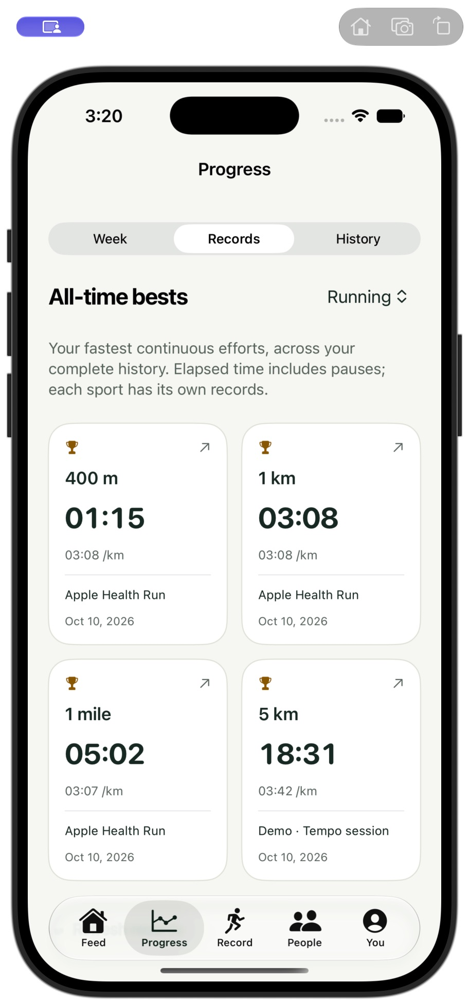
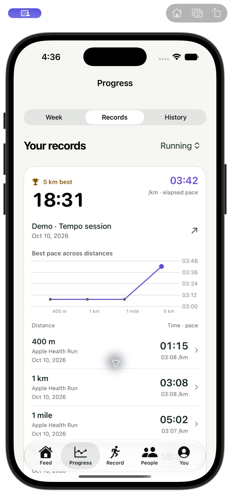

# Interaction and information-density refinement — October 14, 2026

This round implements the pasted design brief in the iPhone interface and the
responsive web app. Evidence below comes from the local **RintDemo** account and
synthetic recordings. Validation is simulator/browser only, as requested.

## Before and after: Records

Both screenshots show the same four all-time benchmarks. The new view gives
one selected achievement prominence, compares pace across benchmark distances,
and names the originating workout and date in each row. The curve compares
distances; it does **not** imply chronological record progression.

| Before | After |
| --- | --- |
|  |  |

## Verified workflows

| Workflow | Actual running evidence |
| --- | --- |
| Repeated native chart taps | Morning run: taps selected 00:31, 00:10 and 00:50, updating pace, heart rate, power and distance together. Tempo session: taps selected 03:40 and 16:45. Selection remained visible after release. |
| Weekly selection | Oct 5 selected 30.0 km, eight workouts and 2:02:28. An empty Sep 14 week remained selectable. Returning to Oct 12 identified the current week as in progress. The later synthetic hills fixture added 6.48 km to that week. |
| All-time record to effort | Tapping the curve selected the 1 mile best and changed its source. Opening the 5 km source opened Tempo session with the exact 00:00–18:31 interval highlighted. Native now scrolls directly to the selected chart. Web shows an explicit “5 km effort” time range. |
| Native route inspection | A location on the hills fixture selected 07:15, 1.57 km, 129 bpm and 208 W. The map marker, legend and chart readouts agreed. Tempo session explicitly offered recorded heart rate because power was unavailable. |
| Web route inspection | A location selected 07:45, 1.67 km, 126 bpm and 193 W. Choosing heart rate or power on the map changed the chart metric while preserving the selected time. A wrapper that swallowed these events was fixed and covered by a regression test. |
| Missing samples | Inspecting the deliberate power gap showed “— W” while distance, pace and heart rate remained available. The curve stayed disconnected across the gap. Route privacy breaks remain separate geometry. |
| Units and absent GPS | Switching to miles changed total distance, chart pace, contextual distance and route pace together. GPS-free workouts retained their sensor charts with a compact explanation instead of an empty map. Constant ranges use a single-colour legend. |
| Feed navigation | Native author text and map opened the activity; the explicit avatar opened the profile. Web avatar, blank card space, map and photo navigation were operated. Like/undo stayed on the feed and did not open an activity. |
| Sharing and exports | Native saved the existing private audience and opened the system share sheet for the local activity link. No destination was selected. Web exported the hills fixture as CSV: header plus 893 normalized sample rows. Native free-export controls remain visible in the sharing editor. |
| Responsive layout | Reviewed at 320, 390 and 1280 pixels. The desktop footer overflow and oversized Records icons were fixed. The measured document width stayed within the viewport. |

The hills fixture deliberately separates GPS, heart-rate and power timestamps,
omits power for an interval and contains a route break. It is seeded only into
the isolated development database by `scripts/rint-demo.py`; personal recordings
are not part of this evidence.

## Design and interaction changes

- Direct chart taps and horizontal scrubbing replace the inspection slider and
  mode switch. Contextual readouts and persistent point/rule markers show the
  selected moment. Cached streams and binary lookup avoid rebuilding sensor
  arrays or requesting the server on each tap.
- Weekly bars show quantity and an actual-values line shows change. The selected
  week, prior-week comparison and incomplete-current-week label provide context.
- Records use a selected achievement, a benchmark curve and compact source
  rows instead of four equal boxes. Standard distances remain canonical while
  pace and mileage respect the user's units.
- Maps use real geographic tiles and recorded sensor values. Their legend
  distinguishes power, heart rate and pace; absent power is never estimated.
- Feed cards emphasize the workout. The explicit avatar is the profile target;
  title, metrics, map, photo and unused body space lead to activity details.
- Activity details retain interval analysis, splits/laps, comparisons and best
  efforts, while reducing padding and duplicate sharing actions. Empty routes,
  photos, captions and notes no longer reserve large empty sections. Calculation
  notes, original-recording management and free exports remain accessible.
- Sharing drops the repeated introductory block and keeps audience, route
  protection, save actions and exports together. Web share metadata now uses
  Rint's mark rather than the old FitTrackee preview image.

## Screenshots

- [Weekly selection](weekly-after.png) — captured before adding the hills fixture.
- [Native repeated chart taps](chart-taps-after.png) — sensor-rich, GPS-free fixture.
- [Native recorded-power route](route-power-after.png).
- [Compact native sharing](sharing-after.png).
- [Web Records, phone](web-records-390.png) and [desktop](web-records-desktop.png).
- [Web exact record interval](web-record-effort.png).
- [Web power inspection](web-power-chart-390.png), [missing power](web-missing-power.png)
  and [320-pixel layout](web-chart-320.png).
- [GPS-free activity](web-no-gps.png).
- [Earlier native activity layout](activity-before.png).

## Checks and limits

- Web: **420 tests across 21 files pass**; lint, type checks and production build
  pass. New coverage checks route-event/unit forwarding, independent sensor
  clocks, missing readings and privacy breaks. Existing loading/failure/retry
  tests pass. Running loading and missing-data states were also inspected.
- Native: **26 tests pass, three opt-in integration checks are skipped** (29
  discovered). Simulator builds, including the Watch companion, succeed.
  New coverage checks chart-edge bins, empty weeks, independent sensor clocks,
  missing samples and privacy breaks.
- Browser dragging and keyboard inspection were operated. Simulator automation
  reliably exercised taps, but its drag/scroll input did not reliably move the
  interface even outside charts. Native finger scrubbing and coexistence with
  vertical scrolling therefore remain unverified.
- The Mac locked during the final native screenshot pass. Records, taps,
  route linking and sharing were inspected before that lock. Final native
  bar-width/plot-clipping refinements compile, but their final visual recheck is
  pending an unlocked simulator. These screenshots are actual captures, not
  mockups or edited composites.
- No physical-device testing or installation occurred in this round. Watch
  recording behavior was not changed or newly exercised. Health permissions,
  background recording, Watch transfers, battery use and push delivery are not
  certified by these UI checks. Earlier validation remains historical evidence.
- Backend calculation methods, imports and synchronization were not changed;
  this round does not claim to rerun those complete workflows. The existing
  web bundle-size warning remains. Exhaustive VoiceOver and slow-network
  performance validation are not claimed.

Logs: `/private/tmp/rint-density-{native-tests,native-build,web-tests,web-lint,web-build}.log`.
Metrics, charts and exports remain free, and the AGPL license and self-hosting
model are preserved. This is a concrete refinement of the primary path, not a
claim that every Strava feature or reliability gap has disappeared.
